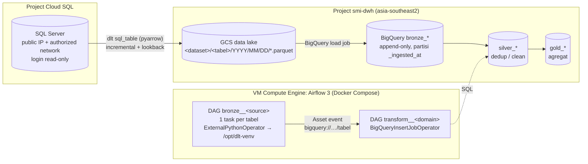

# Airflow Medallion Framework: SQL Server → GCS → BigQuery

Framework ingestion dan transformasi berbasis config untuk **Airflow 3** (Docker Compose di VM):

- **Bronze**: tabel Cloud SQL (SQL Server) di-extract pakai **dlt**, disimpan sebagai file **parquet / jsonl.gz di GCS** (data lake, file lama tetap disimpan), lalu di-load ke **BigQuery** dalam satu pipeline.
- **Silver / Gold**: file SQL biasa yang dijalankan `BigQueryInsertJobOperator`, dengan macro `ref()` / `source()` ala dbt. Dependency terbaca otomatis dan nanti tinggal pindah ke dbt.
- **Nambah tabel cukup edit YAML.** Python-nya tidak perlu disentuh.

> Divalidasi dengan **Airflow 3.3.2 & 3.1.8** (end-to-end) dan **3.0.6** (import DAG), **dlt 1.30.0**, provider google 22.x dan standard 1.19. Detail yang sudah dan belum dites ada di [Status verifikasi](#status-verifikasi).

---

## Arsitektur



| Layer | Isi | Cara tulis | Pola default |
|---|---|---|---|
| Lake (GCS) | File mentah per load (`parquet` / `jsonl.gz`) | otomatis (dlt staging) | disimpan permanen (`keep_files: true`) |
| Bronze (BQ) | Salinan sumber + `_ingested_at`, `_dlt_load_id` | YAML `configs/sources/*.yml` | incremental = **append** (ada duplikat dari lookback), full = **replace** |
| Silver (BQ) | Versi terbaru per PK, tipe & nama rapi | `sql/silver/**.sql` | incremental MERGE dari load bronze sejak progres terakhir tabel silver (− lookback) |
| Gold (BQ) | Agregat / mart | `sql/gold/**.sql` | hitung ulang partisi tanggal yang berubah sejak build terakhir |

### Kenapa dlt (dan jebakannya)

dlt cocok untuk kasus ini: `sql_table` (reflection skema, incremental, arrow) + `destination=bigquery` + `staging=filesystem(GCS)` sudah pas dengan alur DB → GCS → BQ. Framework ini juga menangani beberapa jebakan yang **sudah dicek langsung di source dlt 1.30**:

1. **File di GCS dihapus secara default.** dlt menghapus file staging lama per tabel sebelum load (`truncate_tables_on_staging_destination_before_load=True`), bahkan untuk append. Supaya GCS benar-benar jadi data lake, framework ini mematikannya (`lake.keep_files: true`). Ada test-nya di `tests/test_lake_retention.py`.
2. **Timezone.** `datetime` SQL Server (jam dinding WIB tanpa timezone) disimpan dlt sebagai `TIMESTAMP` BigQuery, yang dibaca sebagai UTC. Di silver pakai `as_local_datetime()` atau `as_utc_timestamp()` (lihat [Macro SQL](#macro-sql)).
3. **Nama kolom cluster.** Hint `CLUSTER BY` table-level di dlt tidak ikut dinormalisasi (`CustomerID` ≠ `customer_id`), jadi `CREATE TABLE` akan gagal. Framework ini otomatis mengirim nama snake_case.
4. **State incremental.** Tiap tabel pakai 1 pipeline dlt (state & schema terpisah), jadi aman jalan paralel. `max_active_tis_per_dag=1` per task mencegah 2 run (termasuk backfill) memakai state tabel yang sama.
5. **Konflik dependency dengan Airflow.** dlt dipasang di venv terpisah (`/opt/dlt-venv`) lalu dipanggil lewat `ExternalPythonOperator`.
6. **Paket load yang gagal.** Kalau run sebelumnya gagal setelah extract, `pipeline.run(data)` dlt hanya me-load paket lama lalu berhenti *tanpa* extract data baru. Runner menyelesaikan paket lama dulu, baru extract.

---

## Struktur repo

```
.
├── dags/                              ← SELURUH isi folder ini di-sync ke <compose>/dags di VM
│   ├── bronze__sqlserver_main.py      ← 1 file kecil per source (isolasi error)
│   ├── transform__sales.py            ← 1 file kecil per domain transform
│   ├── .airflowignore
│   ├── configs/
│   │   ├── platform.yml               ← project BQ, region, bucket lake, timezone
│   │   ├── sources/sqlserver_main.yml ← daftar tabel bronze
│   │   └── transforms/sales.yml       ← daftar model silver/gold
│   ├── sql/{silver,gold}/<domain>/*.sql
│   └── medallion/                     ← framework (tidak perlu diubah untuk kerja harian)
│       ├── config.py  catalog.py  validate.py
│       ├── bronze/    runner.py cli.py connections.py adapters.py   (jalan di venv dlt)
│       └── factory/   bronze_factory.py transform_factory.py        (jalan di Airflow)
├── infra/      gcp_setup.sh (IAM lintas project, bucket, IP statis, authorized network), SQL login read-only
├── scripts/    deploy.sh / deploy.ps1 (sync manual laptop → VM), remote_install.sh
└── tests/      pytest: config, window incremental, e2e dlt, retensi lake, import DAG
```

---

## Setup (sekali)

### 1. GCP & IAM lintas project

Edit variabel di atas `infra/gcp_setup.sh`, lalu jalankan (misalnya di Cloud Shell) oleh admin yang punya akses ke ketiga project:

```bash
bash infra/gcp_setup.sh
```

Yang dilakukan / dicek:

| Item | Nilai |
|---|---|
| SA VM → project `smi-dwh` | `roles/bigquery.jobUser`, `roles/bigquery.dataEditor` |
| SA VM → bucket lake | `roles/storage.objectAdmin` |
| Access scope VM | **harus `cloud-platform`**. Default scope Compute Engine tidak mencakup BigQuery (hasilnya 403 walaupun IAM sudah benar). Mengubah scope butuh VM di-stop. |
| Bucket lake | `gs://smi-dwh-datalake`, region **asia-southeast2** (wajib satu region dengan dataset BQ) |
| IP publik VM | di-promote jadi **statis**. Kalau IP ephemeral berubah setelah VM restart, whitelist di Cloud SQL tidak berlaku lagi. |
| Cloud SQL | IP VM `/32` ditambahkan ke authorized networks (list lama tetap dipertahankan) |

> Kalau VM keluar lewat Cloud NAT (tanpa IP publik), yang didaftarkan adalah IP NAT-nya.

### 2. Login read-only di SQL Server

Jalankan `infra/sqlserver_readonly_login.sql` sebagai admin (`sqlserver`) untuk membuat login `dlt_reader` dengan role `db_datareader`. Pastikan kolom cursor (mis. `ModifiedDate`) punya index.

### 3. Isi config

- `dags/configs/platform.yml`: `bq_project`, `bq_location`, `lake.bucket_url`.
- `dags/configs/sources/sqlserver_main.yml`: tabel-tabel yang di-ingest (contoh di file itu masih dummy, ganti dengan tabel asli).

### 4. Airflow di VM (repo pb-airflow)

Airflow, image (ODBC Driver 18 + venv dlt `/opt/dlt-venv`), `.env`, dan `FERNET_KEY` dikelola repo **pb-airflow**. Repo ini hanya mengisi folder DAG-nya (`/data/airflow/dags`). Sebelum deploy pertama, pastikan:

- Airflow dari pb-airflow sudah jalan (`docker compose up -d`).
- `rsync` terpasang di VM (`sudo apt-get install -y rsync`).
- User SSH bisa menulis ke `/data/airflow/dags`. Kalau tidak bisa, script otomatis memakai `sudo`, dan owner folder tetap dipertahankan.

Versi dlt di `requirements-dev.txt` harus sama dengan `docker/requirements-dlt.in` di pb-airflow.

### 5. Deploy (sync DAG)

```bash
cp scripts/deploy.env.example scripts/deploy.env   # isi VM_NAME, VM_ZONE, VM_PROJECT
./scripts/deploy.sh
# Windows PowerShell: .\scripts\deploy.ps1
```

Urutan kerja script deploy:

1. Validasi lokal (`python -m medallion.validate`: YAML, `ref()`/`source()`, render & syntax SQL).
2. Upload ke VM lewat `gcloud compute scp`.
3. Validasi **lagi di container sekali-pakai** dengan image yang sedang dipakai `airflow-scheduler` (import DAG pakai Airflow asli). Kalau gagal, `/data/airflow/dags` **tidak disentuh**.
4. `rsync --delete` ke `/data/airflow/dags` (update in-place, karena bind mount tidak ikut pindah kalau folder diganti). Tidak perlu restart.

Butuh `gcloud` di laptop dan `rsync` di VM.

### 6. Airflow Connection ke SQL Server

Buat setelah Airflow jalan dengan `AIRFLOW__CORE__FERNET_KEY` terisi (`.env` pb-airflow), supaya password tersimpan terenkripsi. Jalankan dari folder `docker/` pb-airflow. Bisa lewat UI (Admin → Connections, type **Generic**) atau CLI:

```bash
docker compose exec airflow-apiserver airflow connections add mssql_sqlserver_main \
  --conn-type generic \
  --conn-host <IP-public-Cloud-SQL> --conn-port 1433 \
  --conn-login dlt_reader --conn-password '<password>' \
  --conn-schema <NamaDatabase> \
  --conn-extra '{"Encrypt": "yes", "TrustServerCertificate": "yes"}'
```

- `schema` = nama database. Isi `extra` diteruskan sebagai atribut ODBC (driver default `ODBC Driver 18 for SQL Server`).
- Koneksi lewat public IP **selalu terenkripsi** (`Encrypt=yes`). `TrustServerCertificate=yes` diperlukan karena sertifikat Cloud SQL ditandatangani CA per-instance, bukan CA publik. Untuk hardening: pasang `server-ca.pem` di image lalu set `no`, atau pakai Cloud SQL Auth Proxy.
- `google_cloud_default` sudah di-set otomatis oleh compose pb-airflow (pakai SA VM). Project BigQuery dikirim tiap task dari `platform.yml`.
- Password di-mask di log dan di tab *Rendered Template*.

Tes koneksi dari VM: `nc -vz <IP-public-Cloud-SQL> 1433`.

### 7. Run pertama

1. Set `initial_value` tiap tabel incremental. Run pertama akan mengambil data sejak tanggal ini.
2. Untuk tabel besar, set `initial_value` ke tanggal yang dekat (mis. awal bulan ini), lalu isi histori sebelum tanggal itu dengan **backfill** per potongan waktu (lihat [Backfill](#backfill)). Backfill tidak mengubah state incremental.
3. Unpause **`bronze__sqlserver_main` dan `transform__sales`** (compose resmi mem-pause DAG baru). `transform__sales` otomatis jalan setelah semua tabel bronze yang dipakainya ter-update.

---

## Kerja harian

### Tambah tabel (cukup YAML)

```yaml
# dags/configs/sources/sqlserver_main.yml -> tables:
  - table: dbo.SaldoStok             # schema.tabel di SQL Server
    load: incremental                # incremental | full
    cursor: ModifiedDate             # kolom updated/modified (sebaiknya ter-index)
    primary_key: [KodeToko, KodeProduk]
    lookback_hours: 72               # baca ulang 72 jam terakhir dari last_value (data telat)
```

Opsi lain per tabel: `write_disposition` (append/replace/merge), `initial_value`, `target_table`, `cluster_by`, `partition_by`, `included_columns` / `excluded_columns`, `chunk_size`, `backend`, `timeout_minutes`, `on_cursor_null` (raise/include/exclude), `enabled`. Typo key langsung ketahuan, contohnya: `key tidak dikenal: 'primay_key' (maksudnya 'primary_key'?)`.

Nama di BigQuery otomatis snake_case: `dbo.SalesOrderHeader` → `bronze_sqlserver_main.dbo__sales_order_header`, kolom `CustomerID` → `customer_id`.

### Tambah source baru

1. `dags/configs/sources/<nama>.yml` (field `name` harus sama dengan nama file).
2. Copy `dags/bronze__sqlserver_main.py` jadi `dags/bronze__<nama>.py`, lalu ganti baris terakhir jadi `dag = build_bronze_dag("<nama>")`. Docstring-nya jangan dihapus: kata `airflow` dan `dag` wajib ada di file supaya diparse Airflow.
3. Airflow Connection sesuai `airflow_conn_id`. Source Postgres: `type: postgres` (driver psycopg2 sudah ada di image).

`validate` akan protes kalau file `.py`-nya lupa dibuat.

### Tambah model silver / gold

1. Buat `dags/sql/silver/<domain>/<nama>.sql`. Nama file = nama tabel. Copy salah satu pola:
   - `silver/sales/customer.sql`: **incremental MERGE** + dedup (tabel bronze incremental)
   - `silver/sales/product.sql`: **full rebuild** (tabel bronze full)
   - `gold/sales/daily_sales.sql`: **ganti partisi tanggal** yang datanya berubah sejak build terakhir
2. Daftarkan di `dags/configs/transforms/<domain>.yml` → `models:`.
3. Preview SQL hasil render (bisa langsung di-paste ke BigQuery console):
   ```bash
   cd dags && python -c "from medallion.catalog import *; print(render_model_sql(Catalog.load(), 'silver.customer'))"
   ```

#### Macro SQL

| Macro | Hasil |
|---|---|
| `{{ this }}` | tabel model ini, mis. `` `smi-dwh.silver_sales.customer` `` (`this.project/.dataset/.table` juga ada) |
| `{{ ref('silver.customer') }}` | tabel model lain, sekaligus jadi dependency task |
| `{{ source('sqlserver_main', 'dbo.Customer') }}` | tabel bronze, sekaligus pemicu DAG (Asset) |
| `{{ as_local_datetime('modified_date') }}` | `DATETIME(modified_date, 'UTC')` → jam dinding WIB |
| `{{ as_utc_timestamp('modified_date') }}` | `TIMESTAMP(DATETIME(modified_date,'UTC'), 'Asia/Jakarta')` → instant yang benar |
| `{{ params.full_refresh }}` / `{{ params.lookback_days }}` | param DAG (bisa diisi saat trigger manual) |
| `{{ tz }}` | `Asia/Jakarta` |

Hindari `{{ ds }}` / `{{ logical_date }}`: di Airflow 3, run yang dipicu asset tidak punya logical date.

Kalau menambah kolom di model incremental, trigger DAG dengan `full_refresh = true` sekali, karena `INSERT ROW` butuh skema yang sama.

### Backfill

| Cara | Kapan |
|---|---|
| **UI → Trigger DAG** `bronze__…`, isi `backfill_start` + `backfill_end` (tanggal **inklusif**, jam WIB) dan `tables` (opsional) | reload rentang tanggal, 1 run. **Cara yang disarankan.** |
| CLI dlt: `python -m medallion.bronze.cli run sqlserver_main dbo.SalesOrderHeader --start 2025-01-01 --end 2025-06-30` | histori besar, dari laptop / VM |
| `airflow backfill create --dag-id bronze__sqlserver_main --from-date 2025-12-31 --to-date 2026-01-31 --max-active-runs 1` | 1 run per interval jadwal |

Catatan untuk `airflow backfill create`: tiap run mencakup interval jadwal **01:00–01:00 WIB** (bukan per hari kalender), dan `--from-date` dibaca dalam UTC lalu dibulatkan ke jadwal berikutnya. Jadi mulai **satu hari lebih awal** dari tanggal yang dibutuhkan.

Semua mode backfill:

- hanya **menambah** baris ke bronze (append), **tidak mengubah state incremental**, dan tabel `load: full` otomatis di-skip;
- maksimal 1 instance per tabel di semua run (`max_active_tis_per_dag=1`), jadi backfill tidak bentrok dengan run terjadwal;
- aman untuk silver: MERGE punya guard `S.modified_at >= T.modified_at`, jadi versi lama tidak menimpa versi baru.

### Test lokal (tanpa GCP)

```bash
python -m venv .venv && .venv/bin/pip install -r requirements-dev.txt
cd dags && python -m medallion.validate                                   # config + SQL
python -m medallion.bronze.cli list
python -m medallion.bronze.cli run sqlserver_main dbo.Customer --target local    # parquet ke .local/lake
python -m medallion.bronze.cli run sqlserver_main dbo.Customer --target duckdb   # tabel di .local/bronze.duckdb
cd .. && pytest
```

Kredensial untuk CLI ada di `~/.dlt/secrets.toml` (jangan di repo):

```toml
[sources.sqlserver_main.credentials]
host = "34.101.xx.xx"
port = 1433
login = "dlt_reader"
password = "..."
database = "NamaDatabase"
```

Catatan: `--target local` pakai filesystem sebagai destination, jadi tabel `full` di lokal hanya menyimpan snapshot terakhir. Di production (staging GCS + `keep_files: true`) semua snapshot tetap ada. Target lokal punya state terpisah dari production.

Reset satu tabel (drop tabel bronze + state, lalu load ulang dari `initial_value`; file di lake GCS **tidak** ikut terhapus):
`python -m medallion.bronze.cli run sqlserver_main dbo.Customer --refresh drop_resources`

---

## Perilaku penting

- **Hard delete di sumber tidak ter-capture** oleh incremental cursor. Tabel yang butuh delete: pakai `load: full`, atau CDC (Datastream yang sudah ada), atau rekonsiliasi PK berkala.
- **Kolom baru di sumber** otomatis ditambahkan ke bronze (schema evolution dlt). Semua kolom bronze dibuat NULLABLE supaya load tidak gagal kalau sumber berubah.
- **Partisi & cluster** hanya diset saat tabel dibuat. Kalau diubah setelah tabel ada, perlu `--refresh drop_resources`.
- **Cursor bernilai NULL**: query incremental `WHERE cursor >= last_value` tidak pernah mengembalikan NULL. Default `on_cursor_null: raise` menjalankan `COUNT(*) ... WHERE cursor IS NULL` dulu, lalu gagal dengan pesan jelas kalau ada. `include` artinya baris NULL ikut diambil **setiap run**. `exclude` artinya sengaja diabaikan.
- **Beban ke DB sumber**: `max_active_tasks` (default 4) membatasi tabel paralel per run. Untuk batas global lintas run, buat pool (`airflow pools set sqlserver_main 4 "SQL Server main"`) lalu isi `pool: sqlserver_main` di YAML source.
- **Biaya BigQuery**: bronze dipartisi `DATE(_ingested_at)` dan di-cluster per PK, jadi silver incremental hanya scan N hari terakhir. Cek `INFORMATION_SCHEMA` di tiap model kena minimum billing 10 MB.
- **Label job BigQuery** (`layer`, `model`, `pipeline`) bisa dipakai untuk memantau biaya per model di `INFORMATION_SCHEMA.JOBS`.

## Troubleshooting

| Gejala | Penyebab / solusi |
|---|---|
| `403 ... insufficient authentication scopes` | Access scope VM belum `cloud-platform` (setup langkah 1) |
| `Login timeout expired` / `TCP Provider` | IP VM belum ada di authorized networks, atau IP berubah (belum statis) |
| `SSL Provider: certificate verify failed` | Tambahkan `"TrustServerCertificate": "yes"` di extra connection |
| `Can't open lib 'ODBC Driver 18 for SQL Server'` | Container masih pakai image lama: di pb-airflow `docker compose build && docker compose up -d` |
| `Cannot read and write in different locations` | Bucket lake dan dataset BQ beda region |
| DAG tidak muncul | Cek *Import Errors* di UI / `python -m medallion.validate --dagbag`. File DAG harus mengandung kata `airflow` dan `dag` |
| `ConfigError: ...` | Pesan menyebut file & key yang salah. YAML lain tetap jalan karena 1 file DAG per source. |
| Task bronze **skipped** | Ada param `tables` saat trigger, dan tabel itu tidak termasuk |

## Roadmap

1. **dbt**: file `sql/silver|gold/*.sql` sudah pakai `ref()` / `source()` / `this`. Migrasinya: bungkus bagian SELECT jadi model dbt (`materialized='incremental'`, `unique_key`), lalu blok `IF/MERGE` dihapus.
2. **Sync DAG otomatis dari GitHub**: Airflow 3 punya `GitDagBundle` (`apache-airflow-providers-git`, `tracking_ref`, `subdir`, `git_conn_id`). Factory sudah menghitung path dari `__file__`, jadi aman untuk bundle berversi. Atau pakai GitHub Actions yang menjalankan `pytest` + `scripts/deploy.sh`.
3. **Secret Manager**: set `[secrets] backend = CloudSecretManagerBackend`. Kode DAG tidak perlu diubah (tetap `{{ conn[...] }}`).
4. **Data quality**: tambah model/task check (row count bronze vs sumber, freshness `_ingested_at`).

## Status verifikasi

Sudah dites di sandbox (dlt 1.30.0 + Postgres 16 sebagai pengganti sumber). Hasil pytest: **49 passed** (env dlt) dan **28 passed** di masing-masing Airflow 3.3.2, 3.1.8, dan 3.0.6. `airflow dags test` end-to-end dijalankan di 3.3.2 dan 3.1.8. Di 3.0.6 tidak bisa, karena environment sandbox tanpa constraints file (DAG trivial pun gagal di sana); import DAG-nya sendiri sudah lolos.

- Semua DAG ter-import tanpa error. YAML rusak hanya menjatuhkan DAG miliknya sendiri, dan deploy yang gagal validasi tidak menyentuh `dags/` live.
- `airflow dags test` bronze end-to-end: Airflow Connection → template → venv dlt → load. Password tidak bocor di log maupun Rendered Template (`***`). Asset event dan XCom ringkasan terbentuk.
- Incremental + lookback, backfill param, backfill Airflow (konversi UTC → WIB), filter `tables`, dan tabel full yang di-skip saat backfill.
- Paket load yang tertunda diselesaikan dulu, dan window run baru tetap di-extract. Cursor NULL terdeteksi sebelum extract.
- DDL BigQuery yang dibuat dlt (dibangkitkan offline): tipe, `PARTITION BY DATE(_ingested_at)`, `CLUSTER BY` snake_case.
- Retensi file staging (`keep_files`), dites lewat jalur staging dlt yang sama dengan BigQuery. `--refresh` tidak menghapus file lake.
- Render template silver/gold di Airflow asli (`airflow tasks render`), syntax BigQuery via sqlglot, logika SELECT dicoba di DuckDB.
- Kode sudah di-review oleh reviewer independen. Temuannya sudah diperbaiki: backfill paralel, paket tertunda, cursor NULL, lookback silver/gold yang sekarang dihitung dari progres tabel target.

**Belum bisa dites dari sandbox** (akses registry Docker & repo Microsoft diblokir, dan tidak ada akses GCP): build Dockerfile pb-airflow (instalasi `msodbcsql18`), koneksi nyata ke SQL Server via pyodbc, load job nyata ke BigQuery/GCS, dan eksekusi SQL silver/gold di BigQuery. Urutan tes pertama di VM:

1. `docker compose build && docker compose up -d` di pb-airflow, lalu `./scripts/deploy.sh`
2. Trigger `bronze__sqlserver_main` dengan param `tables: ["dbo.Product"]` (tabel kecil), lalu cek tabel BQ dan file di GCS.
3. Trigger 1 tabel incremental dengan `backfill_start`/`backfill_end` 1 hari.
4. Unpause kedua DAG.
